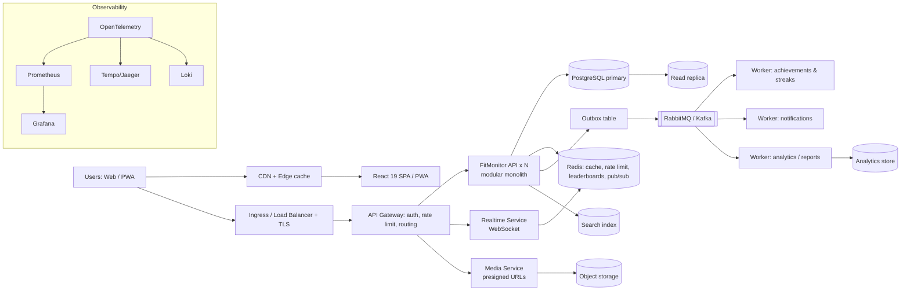

# FitMonitor: A Practice-First System Design Plan

> **Main idea:** Learn system design by **building, deploying, breaking, and scaling FitMonitor**. Every concept is learned *just in time*, at the moment a real feature needs it.
>
> **Duration:** ~7 months at 8–10 hours/week, in 12 milestones (about 2–3 weeks each).
>
> **End result:** A production-style, fully deployed FitMonitor with a documented architecture, measured performance, and observability. It works as your system design portfolio and makes a strong CV project.

---

## 0. How Every Milestone Works: The Practice Loop

Each milestone follows the same 6 steps:

```
1. BUILD    → Ship a real feature that creates a design problem
2. LEARN    → Study only the concepts needed to solve it (just in time)
3. DESIGN   → Draw the design + write an ADR before coding the solution
4. MEASURE  → Load test with k6 and record the numbers BEFORE the fix
5. IMPROVE  → Apply the architecture change, then measure AGAIN
6. BREAK    → Kill a component on purpose and observe what happens
```

**Rules**
- No architecture change without a **reason** (a feature or a measured problem).
- No change is "done" without **before/after numbers** and an **ADR**.
- Commit everything: code, diagrams, load tests, dashboards, infra.

---

## 1. Starting Point

| Area | Today |
|---|---|
| Frontend | React 19, Vite, Tailwind CSS v4, deployed on Vercel |
| Backend | Kotlin + Spring Boot, Spring Data JPA/Hibernate, JWT auth, Dockerized on Render |
| Database | PostgreSQL on Neon |
| Structure | Monorepo |
| Features | Auth, Profile & Settings (personal info, goals, notifications, privacy, devices, appearance) |

---

## 2. Target Architecture (end of the plan)



### Deployment evolution (you'll deploy three times, and each stage teaches something)

| Stage | Where | You learn |
|---|---|---|
| **Stage A** (Milestones 1–4) | Current PaaS (Vercel + Render + Neon) + managed Redis/queue | Managed services, env config, limits of PaaS |
| **Stage B** (Milestones 5–8) | **One VPS with Docker Compose** + Nginx + TLS | Linux, networking, reverse proxy, running your own infrastructure |
| **Stage C** (Milestones 9–12) | **k3s Kubernetes** (on a VPS) + Terraform + GitOps + canary | Orchestration, autoscaling, IaC, zero-downtime releases |

> 💡 For a VPS, look at low-cost providers or cloud free tiers (e.g. Oracle Cloud Always Free, or small Hetzner/DigitalOcean instances). Free-tier terms change, so check current limits and **set billing alerts** before creating anything.

---

## 3. Repo Structure to Create First

```
fitmonitor/
├── apps/
│   ├── web/                 # React 19 frontend
│   ├── api/                 # Spring Boot modular monolith
│   ├── realtime/            # (Milestone 8)
│   └── workers/             # (Milestone 5)
├── infra/
│   ├── docker/              # Compose files (local + Stage B)
│   ├── k8s/                 # Manifests / Helm (Stage C)
│   └── terraform/           # (Milestone 10)
├── load-tests/              # k6 scripts
├── observability/           # Grafana dashboards, alert rules
└── docs/
    ├── architecture/        # C4 diagrams (Excalidraw / Mermaid)
    ├── adr/                 # 0001-use-redis-cache.md ...
    ├── runbooks/            # "What to do when X breaks"
    └── scoreboard.md        # Before/after metrics log
```

---

## 4. The Milestones

### Milestone 0: Foundation & Baseline (Week 1–2)

**Build**
- [ ] Reorganize the repo as above
- [ ] Docker Compose for local dev: API + Postgres
- [ ] GitHub Actions CI: build, test, lint for both apps
- [ ] Health endpoints (`/actuator/health`), structured JSON logs
- [ ] Seed script to generate fake users & workouts (Kotlin or Python + Faker)

**Learn (just in time)**
- Functional vs non-functional requirements, C4 model, back-of-the-envelope estimation, latency numbers

**Design**
- [ ] Write `docs/requirements.md`. Assume a target of **100k users, 10k daily active, peak 200 RPS**, and estimate storage & QPS
- [ ] Draw the C4 Context + Container diagram of the *current* system
- [ ] ADR-0001: "Start as a modular monolith"

**Measure**
- [ ] First k6 test on login + profile endpoints. Record p50/p95/p99 and error rate in `scoreboard.md`

**✅ Done when:** CI is green, there's a baseline in the scoreboard, and diagrams are committed.

---

### Milestone 1: Workout Logging & Data Modeling (Week 3–4)

**Feature:** Log workouts (type, duration, sets/reps, distance, calories), view history, and see weekly stats.

**Learn**
- Relational data modeling, normalization vs denormalization
- B-tree indexes, composite indexes, `EXPLAIN ANALYZE`
- N+1 problem in JPA, fetch joins, projections
- Offset vs **cursor pagination**
- Zero-downtime migrations (expand → migrate → contract) with Liquibase/Flyway

**Build**
- [ ] Workout schema + migrations
- [ ] History endpoint with **cursor pagination**
- [ ] Weekly stats endpoint (aggregations)
- [ ] Seed **5M workout rows**

**Measure → Improve**
- [ ] Load test the history & stats endpoints *without* indexes → record numbers
- [ ] Add indexes, fix N+1 → measure again
- [ ] Compare offset vs cursor pagination on deep pages

**Break**
- [ ] Set the Hikari pool to 2 connections and run the load test. Watch it fail, then write the sizing rule in a runbook

**✅ Done when:** p95 of the history endpoint is under your target (e.g. <150 ms) at 5M rows, with the numbers recorded.

---

### Milestone 2: Caching & Rate Limiting (Week 5–6)

**Feature:** Dashboard (today's summary, streak, weekly chart) and protection against abuse on login.

**Learn**
- Cache-aside, TTL, eviction (LRU/LFU), invalidation, cache stampede
- HTTP caching headers (`Cache-Control`, `ETag`), CDN behavior
- Rate-limiting algorithms: token bucket, sliding window

**Build**
- [ ] Add **Redis** (Docker locally, managed Redis in Stage A)
- [ ] Cache the dashboard with `@Cacheable` and invalidate on workout create
- [ ] Stampede protection (lock or request coalescing)
- [ ] **Redis-backed rate limiter** (Bucket4j) on login & write endpoints
- [ ] Proper cache headers for frontend static assets

**Measure → Improve**
- [ ] Dashboard p95 and DB queries/sec, before vs after caching

**Break**
- [ ] Stop Redis → does the app still work (fail open or fail closed)? Decide which, and write an ADR

**✅ Done when:** a measurable latency drop is recorded and ADR-0002 (caching) and ADR-0003 (rate limiting) are written.

---

### Milestone 3: Auth & Security Hardening (Week 7–8)

**Feature:** Secure sessions across devices (this ties into the "Devices" setting you already have).

**Learn**
- JWT vs sessions, access + **refresh-token rotation**, token revocation
- OAuth2 / OIDC, authorization code + **PKCE** ("Sign in with Google")
- Secure token storage in SPAs (httpOnly cookies vs memory), CSRF, CORS, CSP
- OWASP Top 10, secrets management

**Build**
- [ ] Refresh-token rotation with a reuse-detection check
- [ ] Device/session list with a "log out this device" action (revocation stored in Redis/DB)
- [ ] Google login via OIDC + PKCE
- [ ] Security headers (CSP, HSTS), dependency scanning in CI

**Break**
- [ ] Try replaying an old refresh token → it must be rejected, and the whole session family revoked

**✅ Done when:** the auth flow diagram and threat model are documented in `docs/architecture/auth.md`.

---

### Milestone 4: Media Uploads & Object Storage (Week 9)

**Feature:** Profile photos and progress photos.

**Learn**
- Blob/object storage, **presigned URLs**, CDN for media
- Async image processing (thumbnails)

**Build**
- [ ] MinIO locally, and S3-compatible storage in deployment (e.g. Cloudflare R2 or AWS S3; check current free tiers)
- [ ] Browser uploads directly to storage with a presigned URL (the API never handles file bytes)
- [ ] Thumbnail generation (sync for now; it moves to a worker in Milestone 5)

**Measure**
- [ ] Compare API memory/CPU usage: proxy upload vs presigned upload

**✅ Done when:** photos are served through a CDN URL and ADR-0004 is written.

---

### Milestone 5: Events, Queues & Workers (Week 10–12)

**Feature:** Achievements, streaks, and notifications ("🔥 7-day streak!"), triggered when a workout is logged.

**Learn**
- Why async? Queue vs pub/sub vs log streaming
- RabbitMQ (exchanges, routing, acks) vs Kafka (partitions, consumer groups, offsets)
- At-least-once delivery, **idempotent consumers**, retries with backoff, **dead-letter queues**
- **Transactional Outbox pattern**
- Event schema design & versioning

**Build**
- [ ] Emit a `WorkoutLogged` event via the **Outbox table** (same transaction as the workout insert)
- [ ] Outbox relay → **RabbitMQ** (start here; Kafka is optional later)
- [ ] `workers` app: achievements/streak calculator + notification sender (email/web push)
- [ ] Move thumbnail generation into a worker
- [ ] Idempotency with a processed-message table
- [ ] DLQ + retry policy

**Break**
- [ ] Kill the worker mid-processing → messages must not be lost
- [ ] Send the same event 3 times → the achievement must be awarded only once
- [ ] Stop RabbitMQ → the API must keep accepting workouts (the outbox buffers them)

**➡️ Deployment Stage B:** Move everything to **one VPS with Docker Compose**
- [ ] Nginx reverse proxy + Let's Encrypt TLS
- [ ] Self-hosted Postgres (or keep Neon, and write an ADR on the choice), Redis, RabbitMQ
- [ ] Firewall, SSH keys only, automatic security updates
- [ ] Automated Postgres backups + **a tested restore**
- [ ] GitHub Actions → build images → push to registry → deploy

**✅ Done when:** all 3 break tests pass and the Stage B deployment is live on your domain.

---

### Milestone 6: Horizontal Scaling & Load Balancing (Week 13–14)

**Feature:** None. This milestone is purely about scale, so prepare for a "launch day" traffic spike.

**Learn**
- Vertical vs horizontal scaling, stateless services
- L4 vs L7 load balancing, algorithms, health checks
- Graceful shutdown, connection draining
- Capacity planning

**Build**
- [ ] Make the API fully stateless (no in-memory sessions or caches that need to stay consistent)
- [ ] Run **3 API replicas** behind Nginx with health checks
- [ ] Graceful shutdown in Spring Boot
- [ ] k6 **stress test** and **spike test** scripts

**Measure**
- [ ] Find the breaking point: max RPS with 1 replica vs 3 replicas
- [ ] Identify the new bottleneck (probably the DB). That becomes the next milestone's problem

**Break**
- [ ] Kill a replica during the load test → error rate should stay near zero

**✅ Done when:** a capacity report is in `docs/` ("1 replica handles X RPS; the bottleneck is Y").

---

### Milestone 7: Database Scaling (Week 15–17)

**Feature:** Social features: follow friends, an activity feed, and weekly **leaderboards**.

**Learn**
- Replication (leader-follower), replication lag, **read-after-write consistency**
- Isolation levels, MVCC, optimistic locking (`@Version`), write skew
- Partitioning (PostgreSQL native), sharding concepts, hot partitions
- Connection pooling at scale (PgBouncer)
- Feed design: **fan-out on write vs fan-out on read**
- Redis sorted sets for leaderboards

**Build**
- [ ] Postgres **primary + read replica**; route read-only queries to the replica
- [ ] Solve read-after-write (e.g. read from the primary for a few seconds after a write)
- [ ] **PgBouncer** in front of Postgres
- [ ] Partition the workouts table by month
- [ ] Follow graph + activity feed (start with fan-out on read, then add hybrid fan-out)
- [ ] Weekly leaderboard with **Redis sorted sets**
- [ ] Optimistic locking on goal updates

**Break**
- [ ] Add artificial replica lag → observe stale reads, and verify your fix
- [ ] Stop the replica → reads must fall back to the primary
- [ ] Concurrent goal updates → no lost updates

**✅ Done when:** feed and leaderboard p95 meet targets at 100k seeded users, and ADRs are written for the feed strategy and partitioning.

---

### Milestone 8: Real-Time & Offline-First Frontend (Week 18–19)

**Feature:** **Live workout sessions** (live timer and stats shared with friends) and **offline workout logging**.

**Learn**
- WebSockets vs SSE vs polling
- Scaling WebSockets across servers (sticky sessions or **Redis pub/sub**)
- Reconnection, backoff, message ordering
- PWA: Service Workers, IndexedDB, background sync, conflict resolution
- Core Web Vitals, code splitting, virtualization (for long history lists)

**Build**
- [ ] `realtime` service (Spring WebSocket/STOMP) using Redis pub/sub across 2+ instances
- [ ] Frontend reconnect logic + optimistic UI (TanStack Query)
- [ ] PWA: offline logging queue in IndexedDB that syncs when back online (idempotency keys prevent duplicates)
- [ ] Virtualized workout history list, route-based code splitting
- [ ] Lighthouse CI in GitHub Actions with performance budgets

**Break**
- [ ] Kill one realtime instance → clients reconnect and keep receiving updates
- [ ] Go offline, log 3 workouts, come back online → exactly 3 are saved

**✅ Done when:** Core Web Vitals are "good", the realtime service scales to 2+ instances, and offline sync works.

---

### Milestone 9: Observability & Reliability (Week 20–21)

**Feature:** None. The goal is to "run it like production".

**Learn**
- Logs, metrics, traces; RED & USE methods
- **OpenTelemetry**, Prometheus, Grafana, Loki, Tempo/Jaeger
- SLI / SLO / error budgets, alerting without alert fatigue
- Resilience patterns: timeouts, retries with jitter, **circuit breaker** (Resilience4j), bulkhead
- Backup/restore, RPO/RTO

**Build**
- [ ] OpenTelemetry in the API, workers, and realtime service; frontend RUM/error tracking
- [ ] One trace that follows: browser → API → DB → outbox → queue → worker
- [ ] Grafana dashboards: RED metrics per service, DB, Redis, queue depth
- [ ] **SLOs** (e.g. 99.5% availability, p95 < 300 ms) with alerts
- [ ] Circuit breaker + timeout on external calls (email/push provider)
- [ ] Runbooks for the top 5 failures

**Break (a chaos day)**
- [ ] Slow down the email provider → the circuit breaker opens and the API stays healthy
- [ ] Fill the queue → alert fires
- [ ] Restore the DB from backup → measure your real RTO

**✅ Done when:** you can diagnose any break test using only dashboards and traces.

---

### Milestone 10: Kubernetes, IaC & Zero-Downtime Deploys (Week 22–24)

**➡️ Deployment Stage C**

**Learn**
- Kubernetes: pods, deployments, services, ingress, ConfigMaps/Secrets, probes, HPA
- Helm or Kustomize
- **Terraform** (VPS, DNS, storage buckets)
- GitOps (Argo CD), deployment strategies: rolling, blue-green, **canary**
- Secrets management, cost awareness

**Build**
- [ ] Local cluster with **kind** first, then **k3s** on your VPS (or a small multi-node setup)
- [ ] Manifests/Helm charts for web, api, realtime, workers, Redis, RabbitMQ (Postgres can stay managed; write an ADR)
- [ ] Readiness/liveness probes, resource requests/limits
- [ ] **HPA autoscaling** on the API
- [ ] Terraform for infrastructure + DNS
- [ ] **Argo CD** GitOps deploys
- [ ] **Canary release** (e.g. Argo Rollouts) with automatic rollback when error rate rises

**Break**
- [ ] Deploy a deliberately buggy version → canary detects it and rolls back automatically
- [ ] Delete a node/pod → workloads recover
- [ ] Spike test → HPA scales up, then back down

**✅ Done when:** a `git push` deploys to Kubernetes with a canary and zero downtime.

---

### Milestone 11: Search, Analytics & Architecture Evolution (Week 25–27)

**Feature:** Exercise/workout search, **monthly progress reports** (PDF/email), and an admin analytics dashboard.

**Learn**
- Inverted index, full-text search (Postgres FTS vs OpenSearch/Meilisearch)
- OLTP vs OLAP, **CQRS read models**, Change Data Capture (Debezium, optional)
- Batch jobs, job scheduling
- Modular monolith boundaries, **when to extract a microservice**, strangler fig pattern
- DDD bounded contexts

**Build**
- [ ] Search: start with Postgres FTS, then decide (with an ADR) whether a search engine is needed
- [ ] Analytics read model updated by events (CQRS), connected to your Adinova experience
- [ ] Scheduled monthly report job (worker) → PDF → object storage → email
- [ ] Enforce module boundaries in the monolith (e.g. Spring Modulith)
- [ ] **Extract one service** (e.g. notifications) with its own database, using the strangler approach
- [ ] API gateway in front (routing, auth, rate limiting)

**✅ Done when:** one service is extracted and an ADR explains why it was, and why the rest stays a monolith.

---

### Milestone 12: Payments, Consistency & Final Review (Week 28–30)

**Feature:** **Premium subscription** (use a payment provider's test/sandbox mode only).

**Learn**
- **Idempotency keys** for APIs, webhooks, and exactly-once *effects*
- **Saga pattern** (orchestration vs choreography), compensating actions
- Double-entry ledger basics, reconciliation
- Distributed systems theory review: CAP/PACELC, consistency models, Raft (study it now that you've felt these problems)

**Build**
- [ ] Checkout flow with `Idempotency-Key` headers
- [ ] Webhook handler: signature verification, idempotent, retry-safe
- [ ] Saga: payment → activate premium → send receipt, with compensation on failure
- [ ] Nightly reconciliation job

**Break**
- [ ] Send the same webhook 5 times → premium is activated once
- [ ] Fail the activation step → payment is refunded or flagged

**Final deliverables**
- [ ] Final C4 diagrams (Context, Container, Component)
- [ ] Complete ADR log (expect ~15–20 ADRs)
- [ ] Scoreboard showing the full before/after journey
- [ ] Architecture write-up / blog post: *"How I scaled FitMonitor"*
- [ ] A 10-minute architecture walkthrough video (useful for interviews)
- [ ] Update your CV with real, measured architecture achievements

---

## 5. Scoreboard Template (`docs/scoreboard.md`)

| Date | Milestone | Endpoint / scenario | Change | p95 before | p95 after | Max RPS before | Max RPS after | Notes |
|---|---|---|---|---|---|---|---|---|
| | M1 | GET /workouts (5M rows) | Composite index + cursor | | | | | |
| | M2 | GET /dashboard | Redis cache-aside | | | | | |
| | M6 | Mixed load | 1 → 3 replicas | | | | | |

## 6. ADR Template (`docs/adr/000X-title.md`)

```markdown
# ADR-000X: <Decision title>
Date: YYYY-MM-DD   Status: Accepted

## Context
What problem or measurement forced this decision?

## Options considered
1. Option A: pros / cons
2. Option B: pros / cons

## Decision
What we chose and why.

## Consequences
What we gain, what we pay, and what we must monitor.
```

---

## 7. Theory Alongside Practice (small, steady doses)

Practice leads, but keep **~2 hours/week** for theory so the concepts stick.

| Alongside milestone | Theory to study |
|---|---|
| M0–M1 | Networking basics (TCP, DNS, HTTP/2/3, TLS); database indexes |
| M2–M4 | Caching patterns, CDN, OAuth2/OIDC |
| M5 | Messaging semantics; Kafka design paper |
| M6–M7 | Replication, isolation levels, partitioning; Dynamo paper |
| M8 | WebSocket scaling; CRDTs |
| M9 | Google SRE book chapters (SLOs, monitoring, handling overload) |
| M10 | Kubernetes concepts |
| M11–M12 | DDD, CQRS/event sourcing, CAP/PACELC, Raft |

**Weekly design-problem practice (from Milestone 5 on):** one classic problem per week on paper (URL shortener, rate limiter, chat, news feed, notification system, ride-hailing, payment system, file sync). Then connect it back: *"How would this change FitMonitor?"*

---

## 8. Weekly Routine (~9 hours)

| Day | Focus | Time |
|---|---|---|
| Mon | Learn the milestone's concepts | 1 h |
| Tue | Design: diagram + ADR draft | 1 h |
| Wed | Build | 1.5 h |
| Thu | Build | 1 h |
| Fri | Theory / engineering blog | 1 h |
| Sat | Build + measure + break tests | 3 h |
| Sun | Scoreboard, docs, design problem (M5+) | 1 h |

---

## 9. Resources by Milestone (all free)

| Milestone | Resources |
|---|---|
| All | [System Design Primer](https://github.com/donnemartin/system-design-primer) · [Hello Interview](https://www.hellointerview.com/learn/system-design) · [ByteByteGo Blog](https://blog.bytebytego.com) · [Azure Architecture Center patterns](https://learn.microsoft.com/en-us/azure/architecture/patterns/) |
| M0 | [C4 model](https://c4model.com) · [Excalidraw](https://excalidraw.com) · [k6 docs](https://grafana.com/docs/k6/latest/) · [ADR examples](https://adr.github.io) |
| M1, M7 | [Use The Index, Luke](https://use-the-index-luke.com) · [PostgreSQL docs](https://www.postgresql.org/docs/) · CMU 15-445 (YouTube) · Hussein Nasser (YouTube) |
| M2 | [Redis University](https://university.redis.io) · [Spring Cache guide](https://spring.io/guides/gs/caching) · [Bucket4j](https://bucket4j.com) |
| M3 | [OAuth.net](https://oauth.net/2/) · [OWASP Cheat Sheets](https://cheatsheetseries.owasp.org) |
| M5 | [RabbitMQ tutorials](https://www.rabbitmq.com/tutorials) · [Confluent Developer](https://developer.confluent.io) · [Microservices.io: Outbox](https://microservices.io/patterns/data/transactional-outbox.html) |
| M6 | [Nginx docs](https://nginx.org/en/docs/) · [High Performance Browser Networking](https://hpbn.co) |
| M8 | [web.dev](https://web.dev) · [Patterns.dev](https://www.patterns.dev) · [Spring WebSocket guide](https://spring.io/guides/gs/messaging-stomp-websocket) |
| M9 | [OpenTelemetry docs](https://opentelemetry.io/docs/) · [Grafana tutorials](https://grafana.com/tutorials/) · [Google SRE books](https://sre.google/books/) · [Resilience4j](https://resilience4j.readme.io) |
| M10 | [Kubernetes tutorials](https://kubernetes.io/docs/tutorials/) · [k3s docs](https://docs.k3s.io) · [Terraform tutorials](https://developer.hashicorp.com/terraform/tutorials) · [Argo CD](https://argo-cd.readthedocs.io) · TechWorld with Nana (YouTube) |
| M11 | [Spring Modulith](https://spring.io/projects/spring-modulith) · [Martin Fowler](https://martinfowler.com) · [Meilisearch docs](https://www.meilisearch.com/docs) |
| M12 | [Stripe docs on idempotency & webhooks](https://docs.stripe.com) · [Microservices.io: Saga](https://microservices.io/patterns/data/saga.html) · [Raft](https://raft.github.io) · Martin Kleppmann lectures (YouTube) |

**YouTube channels for theory:** ByteByteGo · Hussein Nasser · Arpit Bhayani · Gaurav Sen · Hello Interview · Jordan has no life · Martin Kleppmann · CMU Database Group · Chirag Goel (FE) · TechWorld with Nana

**Worth buying later:** *Designing Data-Intensive Applications* (Kleppmann), *System Design Interview Vol. 1 & 2* (Alex Xu)

---

## 10. Progress Tracker

- [ ] M0: Foundation & baseline
- [ ] M1: Workout logging & data modeling
- [ ] M2: Caching & rate limiting
- [ ] M3: Auth & security
- [ ] M4: Media & object storage
- [ ] M5: Events, queues, workers + **Stage B deploy**
- [ ] M6: Horizontal scaling
- [ ] M7: Database scaling + social features
- [ ] M8: Real-time & offline-first
- [ ] M9: Observability & reliability
- [ ] M10: Kubernetes, IaC, canary + **Stage C deploy**
- [ ] M11: Search, analytics, service extraction
- [ ] M12: Payments, consistency, final review

> **Remember:** The goal is not to use every technology. The goal is to be able to explain **why** each piece exists, **what it costs**, and **what happens when it fails**. Your scoreboard and ADRs are the proof. 🚀
